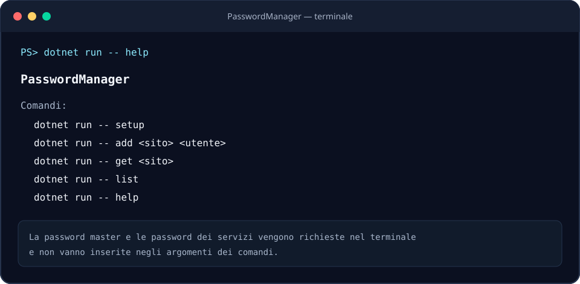

# PasswordManager

A small command-line password manager written in C#/.NET. This project is intended for learning and personal use; it has not undergone an independent security audit.

## Preview

Graphic preview of the `help` command:



## Requirements

- .NET 10 SDK

## Getting started

Open a terminal in the project directory and run:

```sh
dotnet run -- setup
dotnet run -- add example.com alice
dotnet run -- get example.com
dotnet run -- list
```

`setup` creates `vault.dat` and prompts you to enter a master password of at least 12 characters twice. The other commands prompt for it in the terminal without displaying it. When using `add`, press Enter at the password prompt to generate a random password.

The program stores the vault in the current working directory. Run commands from the same directory each time. Keep secure backups of `vault.dat`: there is no recovery process if you lose the file or forget the master password. Do not share the vault file.

## Data protection

The vault uses AES-GCM with an authentication nonce and tag, a random per-vault salt, and PBKDF2-HMAC-SHA-256 with 600,000 iterations to derive a key from the master password. On Unix systems, the file is set to read/write access for the owner only. The master password is neither stored separately nor passed as a command-line argument.

These measures do not replace an independent security audit. Security also depends on the strength of the master password, the device, and backups. Passwords retrieved with `get` are displayed in the terminal.

## Format and compatibility

The vault format is versioned. Earlier versions of the project used a different format and are not migrated automatically. Create a new vault and manually transfer only the data you want to keep.

## License

This project is distributed under the MIT License. See [LICENSE](LICENSE).
